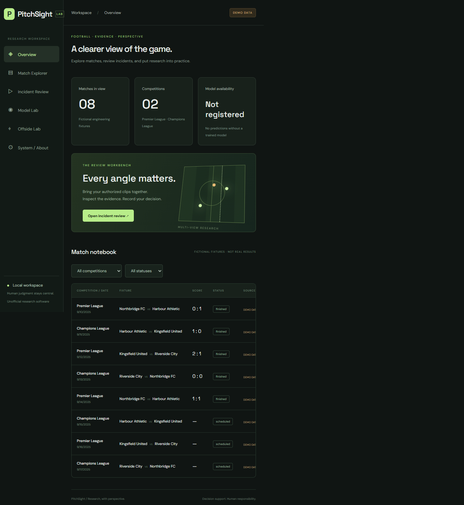
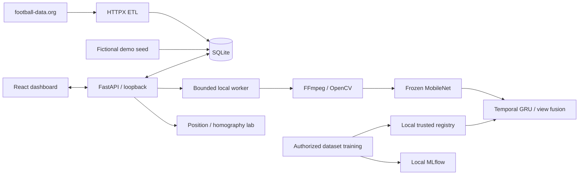

# PitchSight

An unofficial, Windows-native ML research workspace for multi-view football action recognition: dataset audits, GPU training, experiment evaluation, authorized incident clips, and independent human review. Match metadata and offside-position geometry provide supporting context.

**This is not a validated VAR system.** Genuine SoccerNet-MVFoul training and evaluation have run on an RTX 3060. The first model achieved only 21.33% test accuracy and remains inactive. A subsequent validation-only experiment improved validation accuracy to 37.62%; this is not an independent test result. See the [experiment report](docs/first-football-experiment.md) for baselines, abstention, limitations and the confusion matrix. The app opens to Model Lab; fresh installations use explicitly fictional match metadata until a provider token and live sync are configured.



## Run on Windows

Requirements: Python 3.12, Node 22.12+ LTS, Git, and FFmpeg. No Docker, WSL, cloud services, or CUDA Toolkit is needed.

```powershell
cd C:\Users\Denis\PitchSight
powershell -ExecutionPolicy Bypass -File scripts/setup_windows.ps1 -ML
powershell -ExecutionPolicy Bypass -File scripts/run_backend.ps1
# In a second PowerShell terminal:
powershell -ExecutionPolicy Bypass -File scripts/run_frontend.ps1
```

Open **http://127.0.0.1:5173**. API documentation: **http://127.0.0.1:8000/docs**. Scripts invoke the virtual environment directly; activation is unnecessary. The execution-policy override applies only to that PowerShell process.

For the exact verified Windows package versions, install [requirements/windows-verified.txt](requirements/windows-verified.txt) with `--extra-index-url https://download.pytorch.org/whl/cu132`, then install this project with `pip install --no-deps -e .`. This lock is Windows/CUDA-specific; CI installs CPU wheels separately. The frontend uses its committed npm lockfile and `npm.cmd ci`.

```powershell
powershell -ExecutionPolicy Bypass -File scripts/test_all.ps1
.\.venv\Scripts\python.exe scripts/doctor.py
```

## What works

- FastAPI, typed match responses, SQLite foreign keys, idempotent ETL, PL/CL adapter, bounded retry/rate limiting, provider errors and sync audit logs.
- React dashboard with provenance, competition/status filters, incident upload/playback, job status, immutable review history, experiment reports and offside controls.
- Container-signature and decode validation, 100 MiB / 120 s / 4K limits, isolated timed decoding, deterministic frames and thumbnails, FFmpeg browser conversion, grouped camera views.
- One bounded local worker, persistent queued/running/completed/failed states, explicit failure of interrupted jobs after restart.
- Official MV-Foul action-label adapter, clip-content leakage detection, frozen pretrained MobileNetV3 features, logistic baseline, temporal GRU with mean/attention multi-view fusion, missing-view masks, CUDA AMP, accumulation, early stopping and trusted checkpoint resume.
- Local MLflow SQLite tracking, held-out evaluation, validation temperature scaling, reliability plot, abstention, hash-verified model registry and real inference job path.
- Direction-aware offside-position math, uncertainty intervals, homography fitting and reprojection diagnostics. Offence adjudication remains human.

## Data modes

Copy `.env.example` to `.env` if you need custom settings. No credentials are required for demo mode. Demo team names and scores are fictional engineering fixtures, not historical matches.

```powershell
.\.venv\Scripts\python.exe -m pitchsight.cli seed-demo
# For live metadata, set FOOTBALL_DATA_TOKEN securely in .env and PITCHSIGHT_MODE=live:
.\.venv\Scripts\python.exe -m pitchsight.cli sync-matches
```

Restart the backend after changing mode. Live mode does not substitute demo data. Provider subscription restrictions are surfaced; standings are shown as unavailable until ingested. Match metadata does **not** supply labeled foul video.

## Train and register

```powershell
# Small real training loop on synthetic tensors; cannot serve football predictions:
powershell -ExecutionPolicy Bypass -File scripts/train_windows.ps1 -Smoke

# Only after SoccerNet authorization and local extraction; this may take substantial time:
powershell -ExecutionPolicy Bypass -File scripts/train_windows.ps1 -Dataset 'D:\AuthorizedSoccerNet' -Output artifacts/runs/action-v1

# Explicitly trust a locally produced, genuine trained model:
.\.venv\Scripts\python.exe -m pitchsight.inference.registry artifacts/runs/action-v1/manifest.json
```

Models, source clips, feature caches, SQLite files, secrets and MLflow runs are ignored by Git. Uploaded model files are never accepted. Dataset videos/annotations are never downloaded automatically. First genuine feature extraction downloads the official ~10 MB ImageNet MobileNet weights.

## Architecture



See [implementation status](docs/implementation-status.md) for exact executed evidence and blockers, [Windows GPU setup](docs/windows-rtx3060.md), [architecture](docs/architecture.md), [data sources](docs/data-sources.md), [model card](docs/model-card.md), and [security boundaries](docs/security.md). The [private GitHub repository](https://github.com/denisMuso/pitchsight) is published, and its [initial CPU-only Windows CI run passed](https://github.com/denisMuso/pitchsight/actions/runs/41879942060).

Credits: [SoccerNet MV-Foul / VARS](https://github.com/SoccerNet/sn-mvfoul), [football-data.org](https://www.football-data.org/documentation/api), [IFAB Law 11](https://www.theifab.com/laws/latest/offside/), PyTorch and torchvision. This independent project is not affiliated with those organizations.

For dataset acquisition, training preflight, live progress, and the research walkthrough, see [ML workflow](docs/ml-workflow.md).
