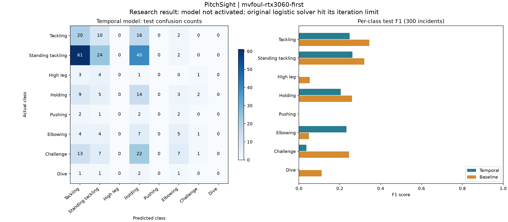

# First authorized football experiment

Run: `mvfoul-rtx3060-first`; MLflow `d5a472220ee141a0aca8180959386436`.
Completed 2026-11-05 UTC. This is a negative research result, not a deployable referee model.

Frozen MobileNetV3 frame features, eight frames per view, first two camera views,
temporal GRU and attention fusion; class-weighted loss; RTX 3060. The original
configuration was fixed before test evaluation. Training stopped after eight epochs;
the best validation loss occurred at epoch three. Temperature was fitted on validation.

| Held-out test measure (300 incidents) | Temporal model | Logistic baseline |
|---|---:|---:|
| Accuracy | 21.33% | 25.00% |
| Macro F1 | 0.1230 | 0.1727 |

The original unscaled logistic solver reached its 500-iteration limit, so its result
is not a converged reference. The most frequent training class is Standing tackling;
always choosing that class would achieve 42.33% test accuracy. Accuracy alone rewards
this imbalanced distribution, but the temporal result is weak under macro F1 too.

At the predeclared 0.65 threshold, the temporal model accepted one test incident and
abstained on 299. The accepted prediction was incorrect. Validation accepted zero of
404 incidents; accepted accuracy is undefined there, not zero. We did not lower the
threshold to produce more confident-looking output.

The paired incident-bootstrap 95% percentile interval for temporal minus logistic
test accuracy is [-9.67, +2.33] percentage points, around a -3.67-point difference
(2,000 bootstrap draws, seed 17). This assumes independent incidents and does not
account for shared-game correlations. It does not establish equivalence or deployment fitness.

Validation accuracy was 30.94% with both selected views versus 12.87% when only the
first view was retained in the same trained checkpoint. This is a masked-view ablation,
not a separately trained single-view baseline or a causal claim about camera count.

The dataset has 2,853/404/300 usable train/validation/test incidents and 71 unknown-label
exclusions. Validation includes only one Dive incident. Exact-content duplication checks
passed; semantic overlap, broadcast bias and game-level dependence remain limitations.

## Engineering verification and decision

An isolated registry loaded the genuine checkpoint and processed two original views
of a test incident. Its probability vector matched the independent audit within 1e-5,
and it returned INCONCLUSIVE with confidence 0.53157. This verifies the inference path;
it does not establish model usefulness. The application registry was left unchanged.

The full local report is `artifacts/runs/mvfoul-rtx3060-first/evaluation-audit.json`.
It retains incident IDs, labels, full model/baseline probabilities, errors, abstentions,
calibration summaries and paired comparisons. Dataset files and checkpoints stay out of Git.

Next development experiment: standardize the baseline using training data only, raise
its solver limit to 2,000 and record convergence. Reduce temporal learning rate from
0.001 to 0.0003 based on the early validation-loss reversal. Evaluate development runs
on validation only. The registry rejects validation-only manifests. The initial test
results remain immutable; further model selection requires independent final evidence.

## Completed validation-only development run

Run `mvfoul-validation-lr3e4`, MLflow `19c92dd300cf4c48bce269f57f1006c8`,
completed on 2026-11-06 UTC. Lower temporal learning rate 0.0003; otherwise the same
temporal architecture and data settings. Early stopping ended at 13 epochs, retaining
epoch eight (validation loss 1.63876 versus the original best 1.71744).

| Validation measure (404 incidents) | Original temporal | New temporal | Standardized logistic |
|---|---:|---:|---:|
| Accuracy | 30.94% | 37.62% | 26.73% |
| Macro F1 | 0.1592 | 0.1917 | 0.1650 |

The standardized logistic solver converged after 284 iterations. Train-only scaling
is folded into its numeric export so inference uses the original feature coordinates.
No test features were extracted or evaluated in this run. These validation results
also informed checkpoint selection and calibration, so they are development evidence,
not an unbiased final estimate. The registry rejected the validation-only manifest as
expected, and no model was activated. This experiment improves development metrics
but does not resolve the weak initial held-out performance.
